# Future Solar CRM — Flow Diagrams (Mermaid)

**Basis:** (1) the company's "Future Solar CRM Flow" chart — six stages, 34 numbered steps; (2) the research report "India solar distributor CRM blueprint" (position as of 26-Oct-2026).
**Renders in:** GitHub, GitLab, Notion, Obsidian, VS Code (Markdown Preview Mermaid Support), mermaid.live.

---

## How to read these diagrams

| Marking | Meaning |
|---|---|
| Node numbers **1–34** | Step numbers taken **exactly** from the company's PDF |
| Node ids starting with **A–Z + number** (e.g. `N1`, `G2`) | Nodes **added from the research** — not in the company's chart |
| **Gold dashed border** | Addition from research (compliance, consent, segmentation, post-dispatch) |
| **Red border** | Hard stop (cannot proceed without fix or approved override) |
| **Amber border** | Warning (proceed with acknowledgement) |

**Ownership colours (from the PDF legend):**

| Colour | Owner |
|---|---|
| Blue | System / CRM |
| Teal | Distributor / DSM |
| Green | End customer |
| Purple | Sales / Techno-commercial |
| Orange | Management / Sales Ops / Accounts |

**Confidence note:** any rule shown inside a diagram that depends on an unverified value is labelled **[config]**. It is read from `rule_config` and is advisory (warning only) until a compliance officer verifies and activates it. See Section 14 for the verify list.

---

## 1. Master flow — company chart plus research extensions

```mermaid
flowchart TD
    classDef sys fill:#DCE9FB,stroke:#2A5DB0,color:#16233F
    classDef dist fill:#D5F0EC,stroke:#1B7A6B,color:#16233F
    classDef cust fill:#E3F3EA,stroke:#1B7A4B,color:#16233F
    classDef sales fill:#E8E1F7,stroke:#4A3AA7,color:#16233F
    classDef mgmt fill:#FDEFD3,stroke:#9A5B00,color:#16233F
    classDef add stroke:#BF9000,stroke-width:3px,stroke-dasharray:5 3

    subgraph S0["Stage 0 — Consent and provenance (research addition)"]
        N0["Lead arrives<br/>Website, Call, WhatsApp, Campaign, Referral, Dealer upload"]:::sys
        N0a["Consent ledger entry<br/>notice version, purposes, channels, named recipients"]:::sys
        N0b["DND scrub and WhatsApp opt-in check"]:::sys
    end
    class N0a,N0b add

    subgraph S1["Stage 1 — Inquiry capture and allocation"]
        A1["1 Inquiry captured"]:::sys
        A2["2 Validate and de-duplicate"]:::sys
        A3["3 Capture details"]:::sys
        A4["4 Territory and capability match"]:::sys
        A5["5 Auto-assign to distributor or DSM"]:::dist
        A7["7 Lead acceptance by distributor"]:::dist
    end

    subgraph S2["Stage 2 — Follow-up and lead classification"]
        B8["8 Initial customer contact"]:::dist
        B9["9 Qualification call"]:::dist
        B10["10 Lead temperature"]:::sys
        B11["11 Lead quality score"]:::sys
        B12["12 CRM follow-up engine"]:::sys
    end

    subgraph S3["Stage 3 — Site visit and opportunity development"]
        N3a["Segmentation fork and rule pack<br/>PMSG, RWA, C and I, Open access, KUSUM, Govt"]:::sales
        C14["14 Customer site visit"]:::sales
        C15["15 Requirement capture form"]:::sales
        N3b["DISCOM feasibility tracking"]:::sales
        C16["16 Product recommendation and brand USP"]:::sales
        C17["17 Technical discussion and solution fit"]:::sales
        C18["18 Rate negotiation with end customer"]:::sales
        C19["19 Convert to opportunity"]:::sales
        C20["20 Update opportunity"]:::sales
    end
    class N3a,N3b add

    subgraph S4["Stage 4 — Quotation and approval"]
        N4a["Compliance engine<br/>ALMM, DCR, BIS, GST, price validity"]:::sys
        D21["21 Prepare techno-commercial offer"]:::sales
        D22["22 Internal price review"]:::sales
        D23["23 Approval matrix<br/>Commercial, Compliance, Credit lanes"]:::mgmt
        D24["24 Send quotation to customer"]:::sales
        D25["25 Customer discussion and negotiation"]:::cust
        D27["27 Commercial terms confirmed"]:::sales
    end
    class N4a add

    subgraph S5["Stage 5 — PI, payment and sales order"]
        E28["28 Prepare proforma invoice"]:::mgmt
        E29["29 PI approval and issue"]:::mgmt
        E30["30 Payment or credit verification"]:::mgmt
        E31["31 Customer PO or order confirmation"]:::cust
        E32["32 Create sales order"]:::sys
        E33["33 SO approval and circulation"]:::mgmt
        E34["34 Hand over to dispatch planning"]:::mgmt
    end

    subgraph S6["After dispatch (research addition)"]
        P1["Serial-number dispatch"]:::sys
        P2["Installation and DISCOM commissioning"]:::dist
        P3["Subsidy claim and loan tracking"]:::mgmt
        P4["Warranty, RMA and 5-year O and M"]:::dist
        P5["Channel scorecard and credit review"]:::mgmt
    end
    class P1,P2,P3,P4,P5 add

    N0 --> N0a --> N0b --> A1
    A1 --> A2 --> A3 --> A4 --> A5 --> A7
    A7 --> B8 --> B9 --> B10 --> B11 --> B12
    B12 --> N3a --> C14 --> C15 --> N3b --> C16 --> C17 --> C18 --> C19 --> C20
    C20 --> N4a --> D21 --> D22 --> D23 --> D24 --> D25 --> D27
    D27 --> E28 --> E29 --> E30 --> E31 --> E32 --> E33 --> E34
    E34 --> P1 --> P2 --> P3 --> P4 --> P5
```

---

## 2. Stage 1 — Inquiry capture and allocation (company chart, with consent additions)

```mermaid
flowchart TD
    classDef sys fill:#DCE9FB,stroke:#2A5DB0,color:#16233F
    classDef dist fill:#D5F0EC,stroke:#1B7A6B,color:#16233F
    classDef mgmt fill:#FDEFD3,stroke:#9A5B00,color:#16233F
    classDef bad fill:#FBE4E2,stroke:#B3261E,color:#16233F
    classDef add stroke:#BF9000,stroke-width:3px,stroke-dasharray:5 3
    classDef ok fill:#E3F3EA,stroke:#1B7A4B,color:#16233F

    S(["Inquiry source<br/>Website, Call, WhatsApp, Campaign, Referral"]):::sys
    X1["Record source and provenance<br/>capture notice version and consent<br/>purposes, channels, named recipients"]:::sys
    X2{"Consent present and DND scrub clear?"}:::sys
    X3["Block promotional outreach<br/>allow service reply only inside window<br/>log reason"]:::bad
    N1["1 Inquiry captured"]:::sys
    N2["2 Validate and de-duplicate<br/>mobile and e-mail valid<br/>check duplicate and existing customer"]:::sys
    X4{"Duplicate or existing owner?"}:::sys
    X5["Ownership lock decision<br/>manager override workflow"]:::mgmt
    N3["3 Capture details<br/>pincode, city, state, MW scale<br/>customer type, product interest<br/>segment"]:::sys
    N4["4 Territory and capability match<br/>territory, MW capacity<br/>product capability, distributor score<br/>vendor registration level and districts"]:::sys
    D1{"Distributor available and eligible?"}:::sys
    N6["6 Escalate to DSM or reassign territory"]:::bad
    N5["5 Auto-assign to distributor or DSM<br/>start acceptance clock"]:::dist
    N7["7 Lead acceptance by distributor"]:::dist
    D2{"Accepted within SLA?"}:::dist
    OK(["Lead accepted"]):::ok
    R1["Reminder 1"]:::bad
    R2["DSM alert"]:::bad
    R3["Auto reassignment to next best distributor"]:::bad
    SLA["Lead acceptance SLA [config]<br/>HOT 15 to 30 min<br/>WARM within 2 hrs<br/>COLD same working day"]:::sys

    S --> X1 --> X2
    X2 -- "No" --> X3 --> N1
    X2 -- "Yes" --> N1
    N1 --> N2 --> X4
    X4 -- "Yes" --> X5 --> N3
    X4 -- "No" --> N3
    N3 --> N4 --> D1
    D1 -- "YES" --> N5 --> N7 --> D2
    D1 -- "NO" --> N6
    N6 -. "reassign" .-> N5
    D2 -- "YES" --> OK
    D2 -- "NO" --> R1 --> R2 --> R3 -. "back to assignment" .-> N5
    SLA -.-> N7

    class X1,X2,X3,X4,X5 add
```

---

## 3. Stage 2 — Follow-up and lead classification

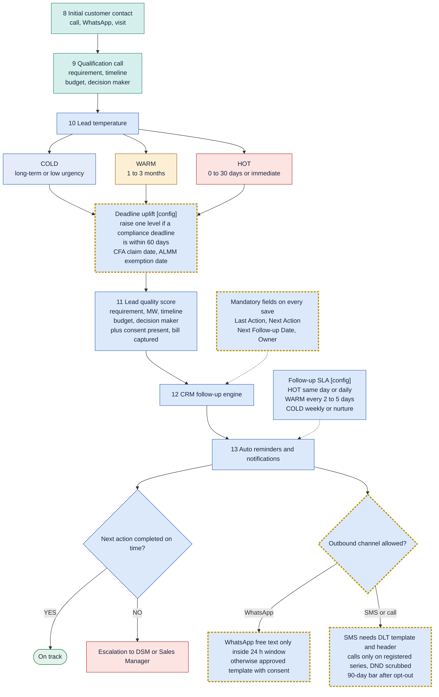

---

## 4. Stage 3 — Site visit and opportunity development

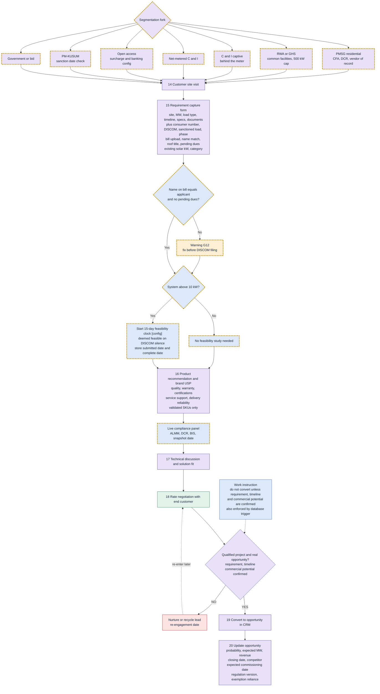

---

## 5. Stage 4 — Quotation and approval

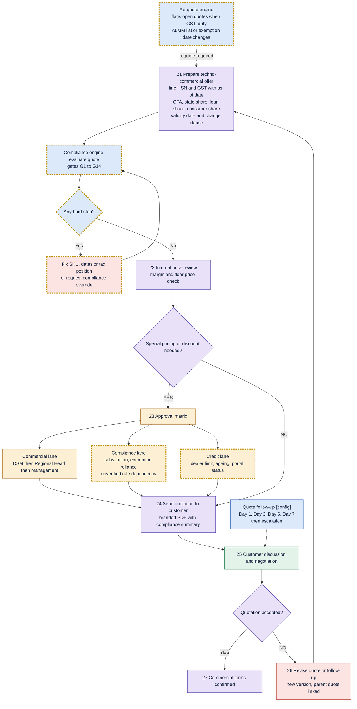

---

## 6. Stage 5 — PI, payment and sales order

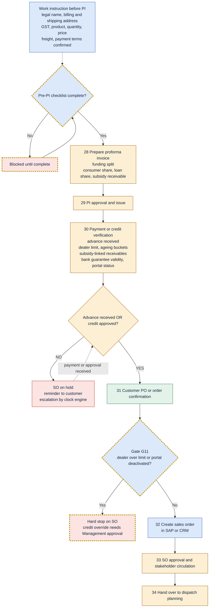

---

## 7. After dispatch — serial dispatch, installation, DISCOM, subsidy, loan, warranty (research addition)

The company chart ends at step 34. The research shows the order stays open for months afterwards.

```mermaid
flowchart TD
    classDef sys fill:#DCE9FB,stroke:#2A5DB0,color:#16233F
    classDef dist fill:#D5F0EC,stroke:#1B7A6B,color:#16233F
    classDef cust fill:#E3F3EA,stroke:#1B7A4B,color:#16233F
    classDef mgmt fill:#FDEFD3,stroke:#9A5B00,color:#16233F
    classDef bad fill:#FBE4E2,stroke:#B3261E,color:#16233F
    classDef add stroke:#BF9000,stroke-width:3px,stroke-dasharray:5 3

    A["34 Hand over to dispatch planning"]:::mgmt
    B["Reserve serials by batch<br/>against SO lines"]:::sys
    C{"Dispatch compliance check<br/>serial snapshot compliant<br/>for the order segment?"}:::sys
    CF["Hard stop<br/>replace serial or approve override"]:::bad
    D["Dispatch note<br/>invoice chain: brand to distributor<br/>to dealer to site<br/>e-way bill and e-invoice status"]:::sys
    E["Installation<br/>vendor of record, geo-tagged photos<br/>installation certificate"]:::dist
    F["Start DISCOM commissioning clock [config]<br/>15 days from certificate submission"]:::sys
    G["DISCOM agreement, meter, commissioning<br/>Gujarat PMSG: regulation version by commissioning date"]:::dist
    H{"Within 15 days?"}:::sys
    HB["Deemed-clock breach logged<br/>escalate with evidence"]:::bad
    I["DISCOM inspection approval"]:::dist
    J["Subsidy claim readiness<br/>bank proof, photos, inspection approval, e-token"]:::mgmt
    K["Start CFA release clock [config]<br/>15 days from DISCOM approval<br/>legacy cohort deadline 30 Nov 2026 [config]"]:::sys
    L["Subsidy received<br/>into consumer or loan account"]:::mgmt
    M["Loan track<br/>bank, status, rejection code<br/>co-applicant, document checklist"]:::mgmt
    N["Close dealer receivable<br/>release subsidy-linked exposure"]:::mgmt
    O["Installed-base register<br/>warranty end, 5-year O and M clock"]:::dist
    P["Warranty or RMA ticket<br/>brand claim number, cost-bearer, TAT clock"]:::dist
    Q["Dealer complaint or MNRE SOP notice"]:::cust
    R["SOP tracker [config]<br/>reply 8 d, reminder 15 d, show-cause 15 d<br/>deactivation 1 month, appeal 30 d"]:::sys

    A --> B --> C
    C -- "Fail" --> CF --> B
    C -- "Pass" --> D --> E --> F --> G --> H
    H -- "No" --> HB --> I
    H -- "Yes" --> I
    I --> J --> K --> L --> N
    M -. "loan disbursal" .-> N
    N --> O --> P
    Q --> R
    R -. "deactivation feeds gate G11" .-> C

    class B,C,CF,D,E,F,G,H,HB,I,J,K,L,M,N,O,P,Q,R add
```

---

## 8. Compliance engine — gate evaluation logic

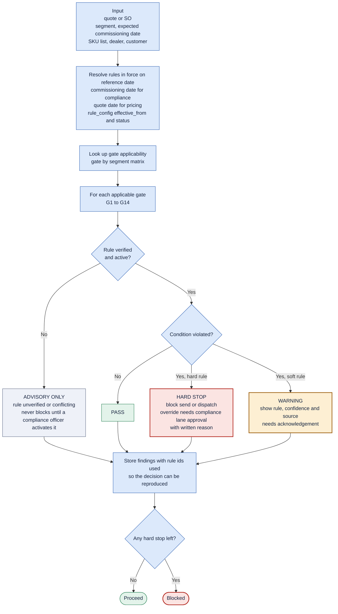

### 8a. Gate catalogue

| Gate | Condition | Default severity when rule is verified and active | Basis confidence |
|---|---|---|---|
| G1 | Promotional message without consent, DND scrub, or within 90-day opt-out bar | Hard stop | High (TRAI Feb 2025 amendment) |
| G2 | PMSG or KUSUM quote with non-DCR module | Hard stop | High (MNRE guideline text) |
| G3 | ALMM-applicable project, module not on List-I (model level) | Hard stop | Medium-High |
| G4 | Subsidy or government project, cells not on List-II | Hard stop | Medium-High |
| G5 | Exemption-reliant job, commissioning after 31 Dec 2026 | Hard stop or override | High on date and scope |
| G6 | BIS licence missing, expired or model mismatch | Hard stop | Medium (standard number conflicting) |
| G7 | Inverter above 200 kW on self-certification after end date | Warning, then hard stop | Medium-High |
| G8 | Quote validity beyond price or duty horizon | Warning | Design rule |
| G9 | GST rate or HSN missing or tax position unapproved | Warning; hard stop for inverters while rule conflicting | Mixed |
| G10 | ALMM snapshot older than N days | Warning | Design rule |
| G11 | Dealer over credit limit or portal-deactivated | Hard stop on SO | Design rule plus MNRE SOP |
| G12 | Bill name mismatch or pending dues | Warning | Medium |
| G13 | PMSG system above 3 kW | Warning | High |
| G14 | Aadhaar number or image captured | Hard stop (policy) | Medium-Low (advisory withdrawn; safe default) |

---

## 9. Consent and messaging decision flow

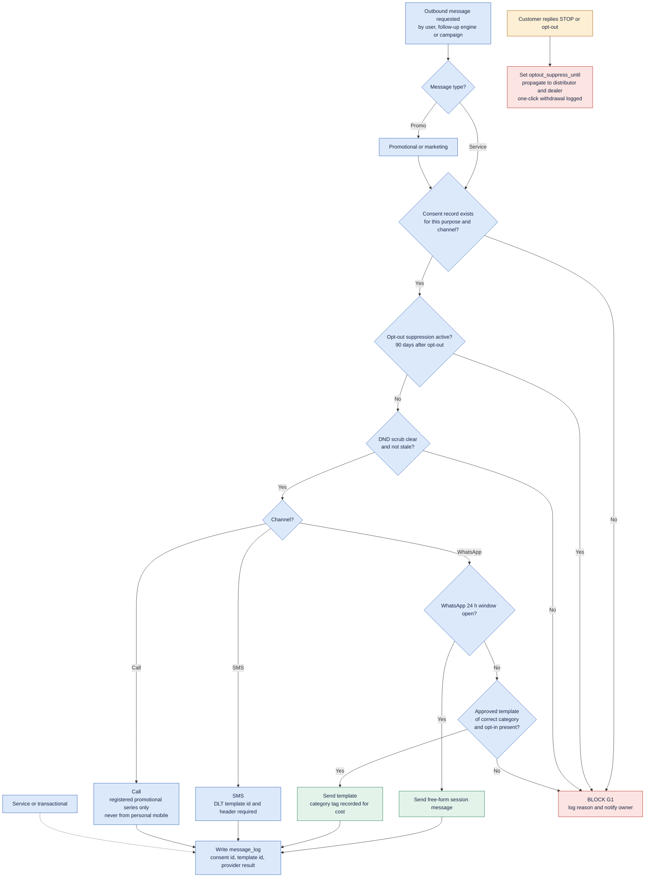

---

## 10. Stage 6 — Escalation matrix and conversion gates (company chart)

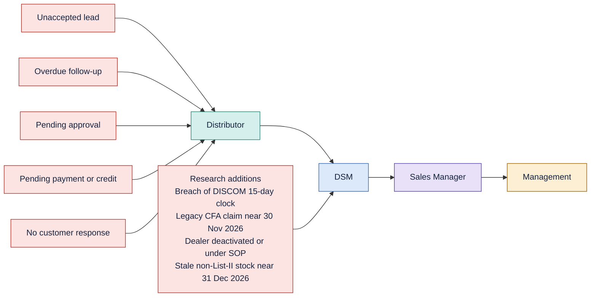

### 10a. Conversion gates and KPIs

| KPI from company chart | Added by research |
|---|---|
| Inquiry → Qualified Lead | Split every conversion by **segment** |
| Qualified Lead → Opportunity | Survey → Quote; Loan approved ÷ Loan applied |
| Opportunity → Quotation | **Compliance-block rate** (quotes blocked by G2–G6 ÷ drafted) |
| Quotation → PI | **Consent coverage** (leads with valid consent before outbound) |
| PI → Sales Order | **DISCOM stage ageing** by DISCOM (median and 90th percentile) |
| First response SLA | Response inside the 24-hour WhatsApp window and 30 min for HOT |
| Follow-up compliance | **CFA pending value and age**; legacy claims at risk |
| — | **Dealer DSO, overdue %, subsidy-linked exposure vs limit** |
| — | Non-List-II stock exposure; RMA turnaround; re-quote rate |

---

## 11. State diagrams

### 11.1 Lead lifecycle

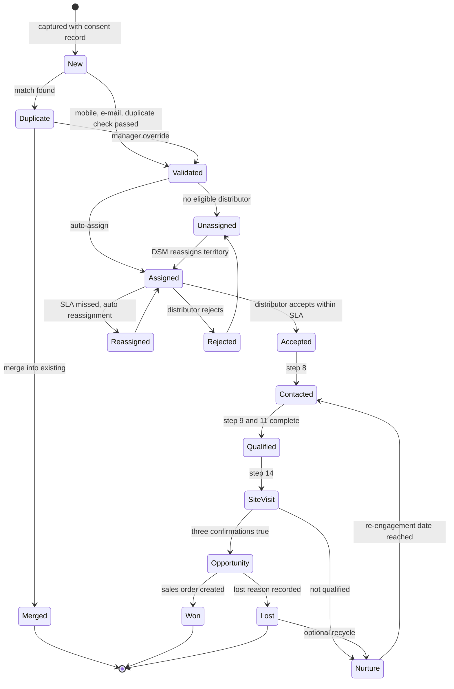

### 11.2 Quotation lifecycle

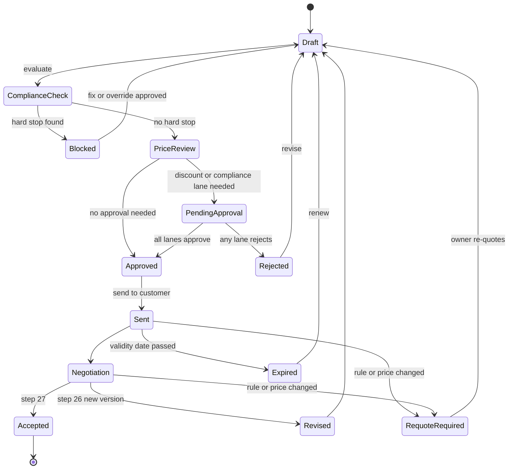

### 11.3 Clock engine states (applies to every clock type)

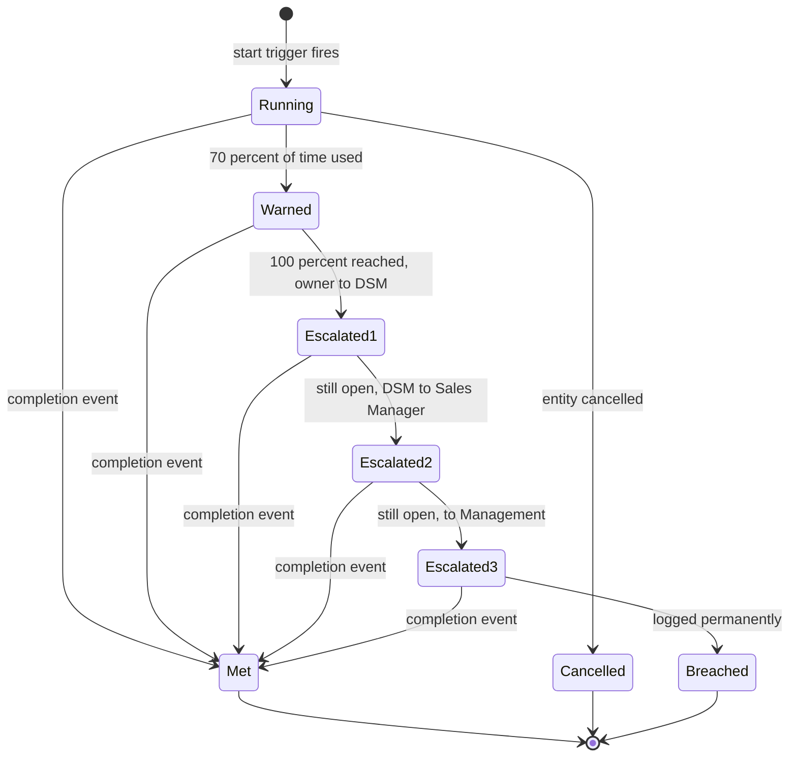

| Clock type | Start trigger | Length source |
|---|---|---|
| `lead_acceptance` | Lead assigned | `sla.lead_acceptance_*` |
| `followup` | Next follow-up date set | `sla.followup_days.*` |
| `quote_followup` | Quote sent | Day 1, 3, 5, 7 |
| `approval` | Approval lane opened | SLA setting |
| `discom_feasibility` | Application complete (above 10 kW) | 15 days **[config]** |
| `discom_commissioning` | Installation certificate submitted | 15 days **[config]** |
| `cfa_release` | DISCOM approval recorded | 15 days **[config]** |
| `legacy_cfa_claim_deadline` | Legacy cohort flag set | 30-Nov-2026 **[config, verify]** |
| `almm_exemption_commissioning` | Exemption-reliant job opened | 31-Dec-2026 |
| `sop_reply`, `sop_show_cause` | MNRE complaint notice logged | 8 and 15 days **[config]** |
| `grievance` | Grievance raised | 30 days |
| `loan_ageing` | Loan applied | Tracked from actual dates (no statutory SLA found) |
| `warranty_rma` | RMA ticket opened | Brand-specific; cost-bearer unknown |

---

## 12. Re-quote engine

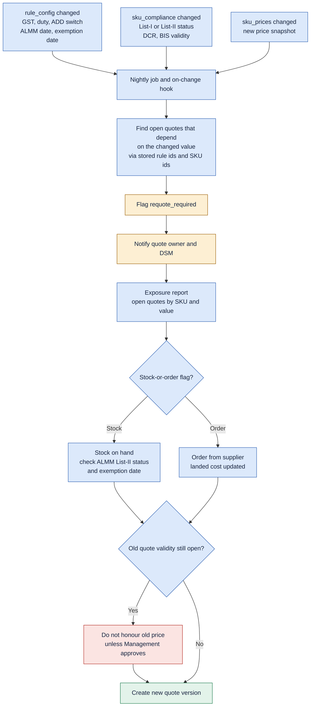

---

## 13. Sequence — one order from lead to subsidy (who talks to whom)

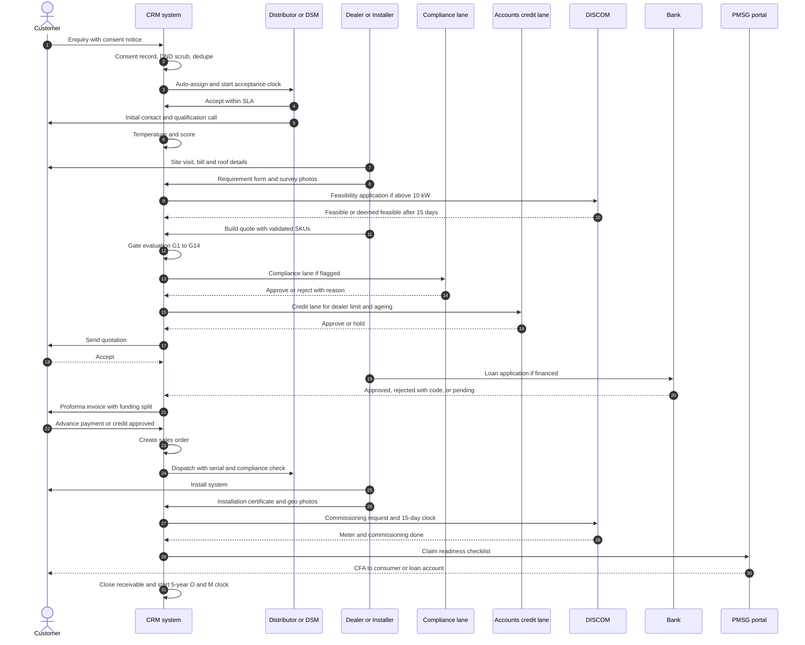

---

## 14. Data model — core entities

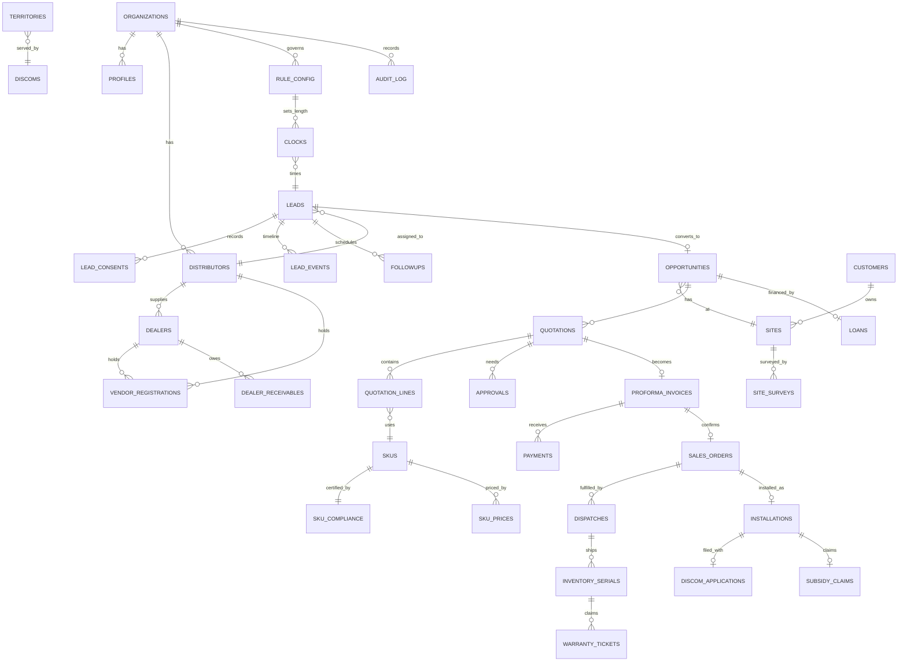

---

## 15. Compliance calendar (confidence as per the report)

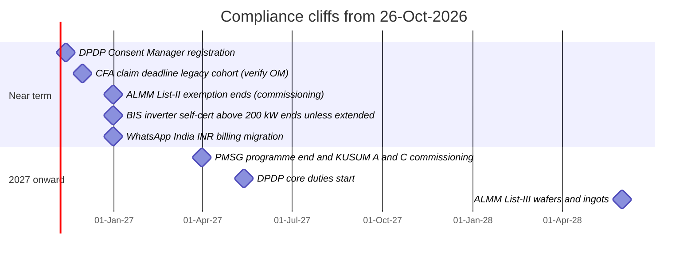

| Date | Event | Days from 26-Oct-2026 | Confidence |
|---|---|---|---|
| 13-Nov-2026 | DPDP Consent Manager registration | 18 | High on date |
| 30-Nov-2026 | CFA claim deadline, legacy cohort | 35 | Medium (OM not read) |
| 31-Dec-2026 | ALMM List-II exemption for net-metering and open-access commissioning ends | 66 | High on date and scope |
| 31-Dec-2026 | BIS self-certification for inverters above 200 kW ends unless extended | 66 | Medium-High |
| 31-Dec-2026 | WhatsApp India INR billing migration deadline | 66 | High |
| 31-Mar-2027 | PMSG programme end; KUSUM Components A and C commissioning | 156 | Medium |
| 13-May-2027 | DPDP core duties (a 12-month compression was proposed, not notified as of 08-Oct-2026) | 199 | High on date as notified |
| 01-Jun-2028 | ALMM List-III | 583 | Medium-High |

---

## 16. Verify before relying — items that change what a diagram shows

| Diagram element | Open question | Where to check |
|---|---|---|
| Legacy CFA deadline (Sections 7, 11.3, 15) | 30-Nov-2026 OM text and scope not read | MNRE OM dated 31-Aug-2026; pmsuryaghar.gov.in |
| Gate G3/G4 and bid-date carve-out | 09-Dec-2024 vs 31-Aug-2025 conflict | MNRE ALMM OMs and FAQ |
| Gate G6 | BIS module standard: IS 14286 vs IS 14086 | BIS / S.O. 492(E) schedule |
| Gate G9 and quote tax lines | Inverter GST 5% vs 18%; 70:30 split unverified | CBIC notifications; CA review |
| Re-quote engine ADD switch | ADD on Chinese cells and modules recommended; notification unconfirmed | CBIC customs notifications |
| Gate G2 | A vendor guide claims PMSG needs no DCR; MNRE text and press say it does | MNRE guideline clause |
| Section 7 clocks | DISCOM stage SLAs: only the 15-day rules were found; no statutory SLA for other stages | Rights of Consumers Rules; DISCOM circulars |
| Section 7 Gujarat branch | Gujarat state subsidy and net-metering specifics from a summary and a vendor blog | GR, GERC gazette, GEDA |
| Sections 2, 3, 9 | TRAI series (1600 vs 160) and header suffix (-P vs -F); Third Amendment status | TRAI gazette; DoT |
| Section 9 | DPDP deemed consent, grievance timelines, exemptions not verified | DPDP Rules gazette |
| Distributor margins, credit days, conversion rates | **No reliable data** — vendor hypotheses | Interviews with 5–10 Gujarat distributors |

---

## 17. Mapping — company chart step to diagram and to build prompt

| Chart step | Name | Diagram section | Notes |
|---|---|---|---|
| 1 | Inquiry captured | 2 | Consent and provenance added |
| 2 | Validate and de-duplicate | 2 | Ownership lock added |
| 3 | Capture details | 2 | Segment required |
| 4 | Territory and capability match | 2 | Vendor registration level and districts added |
| 5 | Auto-assign to distributor / DSM | 2 | Acceptance clock |
| 6 | Escalate to DSM / reassign | 2 | |
| 7 | Lead acceptance by distributor | 2 | SLA 15–30 min / 2 h / same day |
| 8 | Initial customer contact | 3 | Channel rules added |
| 9 | Qualification call | 3 | |
| 10 | Lead temperature | 3 | Deadline uplift added |
| 11 | Lead quality score | 3 | Consent and bill captured added |
| 12 | CRM follow-up engine | 3 | Mandatory fields enforced |
| 13 | Auto reminders and notifications | 3 | WhatsApp window logic |
| 14 | Customer site visit | 4 | Geo-tagged photos |
| 15 | Requirement capture form | 4 | DISCOM and bill fields added |
| 16 | Product recommendation and brand USP | 4 | Validated SKUs only |
| 17 | Technical discussion and solution fit | 4 | |
| 18 | Rate negotiation with end customer | 4 | |
| 19 | Convert to opportunity | 4 | DB trigger on three confirmations |
| 20 | Update opportunity | 4 | Commissioning date and regulation version added |
| 21 | Prepare techno-commercial offer | 5 | Tax, CFA split, validity |
| 22 | Internal price review | 5 | Floor price |
| 23 | Approval matrix | 5 | Three lanes |
| 24 | Send quotation to customer | 5 | |
| 25 | Customer discussion / negotiation | 5 | |
| 26 | Revise quote / follow-up | 5 | Versioning |
| 27 | Commercial terms confirmed | 5 | |
| 28 | Prepare proforma invoice | 6 | Funding split |
| 29 | PI approval and issue | 6 | |
| 30 | Payment / credit verification | 6 | Dealer exposure added |
| 31 | Customer PO / order confirmation | 6 | |
| 32 | Create sales order (SAP / CRM) | 6 | Gate G11 |
| 33 | SO approval and circulation | 6 | |
| 34 | Hand over to dispatch planning | 6, 7 | Flow continues in Section 7 |
